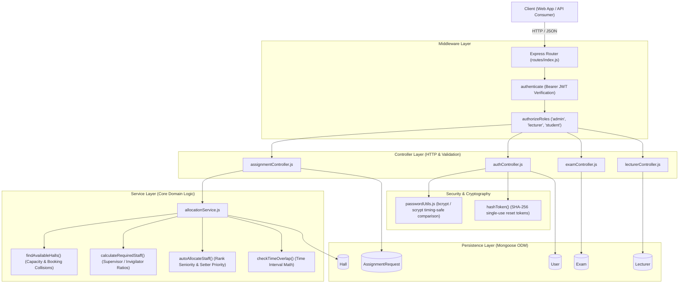

# Smart Exam Invigilation & Hall Allocation Engine

[](.github/workflows/test.yml)
[](https://nodejs.org)
[](#system-architecture)
[-success?style=flat)](#automated-testing--ci)

A domain-driven backend system built with **Node.js**, **Express**, and **MongoDB (Mongoose)** that automates university exam invigilation, supervisor ratios, lecturer seniority rank hierarchy, and physical hall collision detection.

---

## Authorship & Contribution Disclosure

> [!NOTE]
> **Engineering Scope**: This repository represents the backend core logic of the exam scheduling and hall allocation system. My primary focus and contributions include:
> - Architecting the **Allocation Service** (`services/allocationService.js`) implementing complex scheduling heuristics (staffing ratios, rank hierarchy, and hall conflict resolution).
> - Hardening authentication and authorization with **secure password hashing**, **SHA-256 hashed reset tokens**, and **Role-Based Access Control (RBAC)** middleware.
> - Decoupling the codebase following the **Service Layer Pattern** (`Route -> Middleware -> Controller -> Service -> Model`).
> - Establishing an automated unit and integration test suite using Node's native test runner with continuous integration via GitHub Actions.

---

## System Architecture



---

## Core Allocation Rules & Domain Policies

The allocation engine (`services/allocationService.js`) enforces strict university academic regulations:

### 1. Supervision & Invigilation Ratios
- **Supervisors**: $\lceil \text{studentCount} / 180 \rceil$ (1 supervisor per 180 students).
- **Invigilators**: Baseline of 1 invigilator. If $\text{studentCount} > 25$, $+1$ additional invigilator for each 15 students:
  $$\text{Invigilators} = 1 + \left\lceil \frac{\text{studentCount} - 25}{15} \right\rceil$$

| Student Count | Supervisors Required | Invigilators Required |
|---|---|---|
| **1 – 25** | 1 | 1 |
| **26 – 40** | 1 | 2 |
| **41 – 55** | 1 | 3 |
| **180** | 1 | 12 |
| **181** | 2 | 12 |

### 2. Academic Rank Hierarchy
- **Paper Setter Priority**: The course paper setter is prioritized as the primary supervisor if available and not on approved academic leave (`isTL: false`).
- **Supervisor Seniority**: Additional supervisors are chosen from senior academic ranks (`Professor`, `Senior Lecturer Gr I/II`) within the subject's faculty.
- **Rank Inversion Prevention**: Invigilators must possess an academic rank strictly lower (numerically greater in rank index) than the lowest supervisor rank assigned to that hall.

### 3. Collision & Availability Resolution
- **Time Interval Overlap**: Intervals are checked using boundary-safe comparisons ($!(end_1 \le start_2 \lor start_1 \ge end_2)$).
- **Lecturer Schedule**: Automatically checks against prior assignments and self-declared unavailabilities.
- **Hall Capacity & Collisions**: Exam halls are validated for both physical seating capacity ($\text{capacity} \ge \text{requiredCount}$) and time-slot availability across existing hall bookings.

---

## Security & Reliability Hardening

| Component | Security Risk Addressed | Implementation Details |
|---|---|---|
| **Database Credentials** | Hardcoded credentials in source code. | Extracted connection strings to `process.env.MONGO_URI` with safe local fallbacks in `.env.example`. |
| **Password Storage** | Plaintext password storage and comparison. | Implemented `bcrypt` / secure scrypt with cryptographically random salt and timing-safe evaluation (`passwordUtils.js`). |
| **Password Reset Tokens** | Plaintext tokens in DB; internal error leaks. | Stored as single-use SHA-256 hashes with 15-minute expiry; uniform responses prevent user enumeration. |
| **Access Control (RBAC)** | Privilege escalation where students could access admin routes. | Case-insensitive role middleware (`authorizeRoles`) and server-side ownership checks on assignments. |
| **API Error Sanitization** | Database stack traces returned in 500 responses. | Internal errors are logged on the server while returning sanitized, generic JSON messages to clients. |

---

## API Reference

### Authentication & Account
| Method | Endpoint | Auth | Description |
|---|---|---|---|
| `POST` | `/api/auth/register` | Public | Register new user with hashed credentials. |
| `POST` | `/api/auth/login` | Public | Authenticate user credentials and receive JWT. |
| `POST` | `/api/auth/forgot-password` | Public | Request secure password reset link (anti-enumeration). |
| `POST` | `/api/auth/reset-password` | Public | Reset password using hashed reset token. |
| `GET` | `/api/auth/profile` | Authenticated | Retrieve authenticated user profile (password stripped). |
| `GET` | `/api/auth/student-timetable` | Student / Admin | Retrieve exam timetable filtered by department. |
| `GET` | `/api/auth/lecturer-notifications` | Lecturer / Admin | Retrieve supervision and invigilation notifications. |

### Exam Allocation & Scheduling
| Method | Endpoint | Auth | Description |
|---|---|---|---|
| `POST` | `/api/assignments/auto-assign` | Admin | Execute automatic supervisor & invigilator allocation. |
| `GET` | `/api/assignments/conflicts` | Admin / Lecturer | Scan for overlapping staff assignments. |
| `POST` | `/api/assignments/finish` | Admin / Lecturer | Mark exam session finished and verify hall availability. |
| `GET` | `/api/assignments/admin/view` | Admin | View all exam assignment requests. |
| `PUT` | `/api/assignments/status/:id` | Admin / Lecturer | Update assignment status (ownership enforced). |

### Exam & Lecturer Management
| Method | Endpoint | Auth | Description |
|---|---|---|---|
| `POST` | `/api/exams/create` | Admin | Schedule a new exam session with subject parameters. |
| `GET` | `/api/exams/available-halls` | Authenticated | Filter halls meeting capacity and availability constraints. |
| `POST` | `/api/lecturers/create` | Admin | Register academic staff with rank and department. |
| `GET` | `/api/lecturers/available` | Authenticated | Query academic staff available for a specific time window. |

---

## Getting Started

### Prerequisites
- **Node.js**: `^18.0.0`, `^20.0.0`, or `^22.0.0`
- **MongoDB**: `^6.0.0` (local instance or MongoDB Atlas)

### Local Setup
1. **Clone the repository**:
   ```bash
   git clone <repo-url>
   cd ideaIgniters2
   ```

2. **Configure environment variables**:
   ```bash
   cp .env.example .env
   ```
   Edit `.env` to configure your local database and JWT secret:
   ```env
   PORT=3000
   MONGO_URI=mongodb://127.0.0.1:27017/exam_allocation
   JWT_SECRET=your_super_secret_jwt_key
   ```

3. **Install dependencies**:
   ```bash
   npm install
   ```

4. **Start development server**:
   ```bash
   npm run dev
   ```

---

## Automated Testing & CI

The test suite runs using Node.js's native test runner (`node --test`), requiring zero external test dependencies:

```bash
# Run all unit and security test suites
npm test

# Run syntax and linter checks
npm run lint
```

### Test Coverage Highlights
- **`tests/allocationService.test.js`**: Validates staff ratio math (all student boundaries), interval overlaps, lecturer availability checks, hall capacity checks, and rank priority auto-allocation.
- **`tests/auth.test.js`**: Validates password hashing, timing-safe password comparison, SHA-256 token hashing, and RBAC role middleware protection.
- **`tests/timeUtils.test.js`**: Validates time string overlap detection and date formatting.
